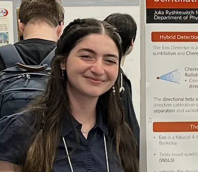

```{=html}
<div class="site-page">
  <section class="inner-banner"><div class="inner-shell"><span class="eyebrow">The people behind the physics</span><h1>Meet the group.</h1><p>Graduate students, postdoctoral researchers, and collaborators working together on rare-event physics and experimental neutrino detection.</p></div></section>
  <section class="section-shell" aria-labelledby="team-title"><div class="section-topline"><span class="section-kicker">Current members</span><span class="section-count">As of November 2026</span></div><h2 id="team-title" class="section-title">Our team.</h2>
    <div class="people-grid">
      <article class="person"><h3>Christopher P. Grant</h3><p>Principal Investigator<br>Associate Professor of Physics</p></article>
      <article class="person"><h3>Ömer Penek</h3><p>Postdoctoral Researcher<br>KamLAND-Zen and CUPID</p></article>
      <article class="person"><h3>Anika Katt</h3><p>Graduate Student<br>CUPID and Eos</p></article>
      <article class="person"><h3>Julia Ryshkewitch</h3><p>Graduate Student<br>Eos and KamLAND-Zen</p></article>
      <article class="person"><h3>So Young Jeon</h3><p>Graduate Student<br>KamLAND-Zen and Eos</p></article>
    </div>
  </section>
  <section class="dark-band" aria-labelledby="alumni-title"><div class="section-shell"><span class="section-kicker">Group alumni</span><h2 id="alumni-title" class="section-title">Where research leads.</h2>
    <div class="compact-grid compact-grid--on-dark">
      <div class="compact-item"><strong>Hasung Song</strong><span>Ph.D. 2025 · Postdoctoral researcher, UC Berkeley</span></div>
      <div class="compact-item"><strong>Diana Gooding</strong><span>Ph.D. 2025 · MIT Lincoln Laboratory</span></div>
      <div class="compact-item"><strong>Aobo Li</strong><span>Ph.D. 2020 · Faculty, UC San Diego</span></div>
      <div class="compact-item"><strong>Katarzyna Frankiewicz</strong><span>Postdoctoral researcher, 2019–2022</span></div>
      <div class="compact-item"><strong>Pedro Baculima</strong><span>Undergraduate researcher · Graduate studies at CU Boulder</span></div>
    </div>
  </div></section>
</div>
```
